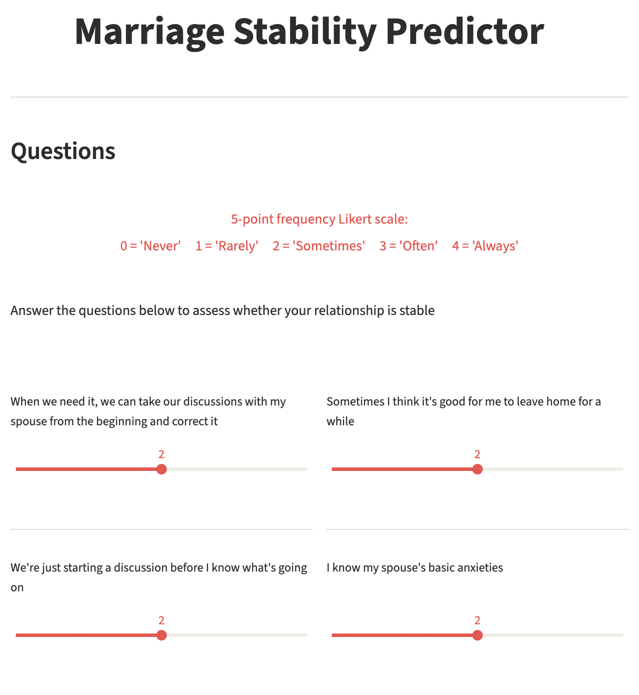

## Can Six Questions Predict Divorce?

## Overview

Relationship researchers have spent decades trying to understand why some couples stay together while others separate.

One of the most influential frameworks in this area comes from psychologist John Gottman, whose work inspired the development of the Divorce Predictor Scale (DPS), a questionnaire containing 54 statements about communication, trust, emotional awareness and conflict management.

This project started with a simple but ambitious question:

> Can the predictive power of a 54-question relationship assessment be preserved using only a handful of questions?

Using machine learning, feature selection and cross-validation techniques, I investigated whether the predictive power of the original questionnaire could be preserved with drastically fewer questions.

The result was surprising.

The final model retained only 6 statements out of the original 54 while maintaining an F1-score close to 0.99.

The project was then deployed as a production-ready application using FastAPI, Render and Streamlit.

## Live Demo

📱 Try the application:
[Marriage Stability Predictor](https://marriage-stability-prediction.streamlit.app)

📖 Explore the API:
[FastAPI Documentation](https://marriage-prediction-api.onrender.com/docs)

## Project Goal

The original Divorce Predictor Scale contains 54 statements describing communication patterns, trust, emotional awareness, conflict management and other aspects of relationship dynamics.

The existence of a 54-statement questionnaire naturally raises an interesting question.

If marital stability can be predicted from these 54 statements, how much of that information is actually necessary?

Do all 54 statements contribute meaningfully to the prediction, or is most of the predictive signal concentrated in a much smaller subset of questions?

The objective of this project was therefore not simply to build an accurate prediction model, but to investigate the limits of dimensionality reduction in this context.

More specifically, the project sought to answer the following question:

> How far can the questionnaire be reduced before its predictive power begins to break down?

To answer this question, multiple feature selection and redundancy reduction techniques were explored in order to identify the smallest subset of statements capable of preserving the predictive power of the original assessment.

## From 54 Questions to 6

The answer turned out to be more surprising than expected.

Recursive Feature Elimination with Cross-Validation (RFECV) was first used to identify the most influential statements in the questionnaire. The highest-ranked variables were then examined for redundancy in order to determine whether a smaller and more interpretable model could be built without sacrificing predictive performance.

This process ultimately reduced the original 54-statement questionnaire to only 6 statements while maintaining near-identical predictive performance.

The final model retained the following statements:

### 1. Communication Repair

> When we need it, we can take our discussions with my spouse from the beginning and correct it.

### 2. Trust Alignment

> My spouse and I have similar values in trust.

### 3. Emotional Awareness

> I know my spouse's basic anxieties.

### 4. Conflict Escalation

> We're just starting a discussion before I know what's going on.

### 5. Withdrawal Tendencies

> Sometimes I think it's good for me to leave home for a while.

### 6. Defensiveness

> I have nothing to do with what I've been accused of.

Taken together, these six statements capture several core dimensions of relationship functioning:

- communication repair;
- trust and shared values;
- emotional awareness;
- conflict escalation;
- withdrawal behaviours;
- defensiveness and blame dynamics.

## Methodology

The project followed a complete machine learning workflow, moving from data exploration to deployment.

```text
Original DPS Dataset (54 Statements)
                │
                ▼
      Data Preparation
                │
                ▼
 Exploratory Data Analysis
                │
                ▼
            RFECV
 (Feature Importance Ranking)
                │
                ▼
     Redundancy Analysis
                │
                ▼
      Reduced Feature Set
          (6 Statements)
                │
                ▼
      Logistic Regression
                │
                ▼
       GridSearchCV Tuning
                │
                ▼
      Cross-Validation
                │
                ▼
         Final Model
                │
                ▼
           FastAPI
                │
                ▼
          Streamlit
```

## Results

The most important result of this project is not the model's accuracy.

It is the fact that the original 54-statement assessment could be reduced to only 6 carefully selected statements while preserving almost all of its predictive power.

54 statements

↓

6 statements

↓

89% reduction in questionnaire size

↓

F1-score ≈ 0.99

Despite removing nearly 90% of the original questionnaire, the final model maintained excellent predictive performance across all evaluation metrics.

### Final Cross-Validation Performance

| Metric | Score |
|----------|----------|
| Accuracy | 0.988 ± 0.024 |
| Precision | 1.000 ± 0.000 |
| Recall | 0.978 ± 0.044 |
| F1-score | 0.988 ± 0.024 |
| ROC-AUC | 1.000 ± 0.000 |

These results suggest that a relatively small number of relationship characteristics may capture a large proportion of the predictive information contained within the original assessment.

While the project does not claim to replace the underlying psychological framework of the Divorce Predictor Scale, it demonstrates that much of its predictive signal can be preserved using a substantially reduced set of statements.

## Screenshot

### Streamlit Web Application



## Technologies Used

### Data Science & Machine Learning

- Python
- Pandas
- NumPy
- Scikit-learn

### Model Selection & Optimization

- RFECV
- GridSearchCV
- Cross-Validation

### Backend

- FastAPI
- Uvicorn

### Frontend

- Streamlit

## Project Structure

```text
marriage_prediction_api
│
├── models/
│   └── reduced_model_6.pkl
│
├── src/
│   └── api/
│       └── main.py
│
├── README.md
├── requirements.txt
└── start.sh
```

## API Example

The model can be queried through a FastAPI endpoint.

### Request

```json
{
  "begin_correct": 4,
  "trust": 4,
  "anxieties": 4,
  "idk_what_s_going_on": 0,
  "good_to_leave_home": 0,
  "accusations": 0
}
```

### Response

```json
{
  "prediction": 1,
  "stable_prob": 0.999,
  "divorce_prob": 0.001
}
```

## Running Locally

Install the dependencies:

```bash
pip install -r requirements.txt
```

Start the API:

```bash
bash start.sh
```
